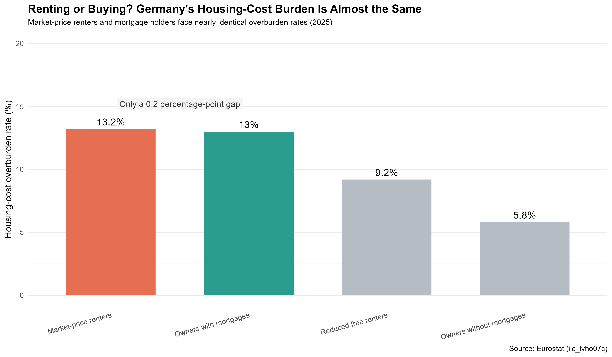
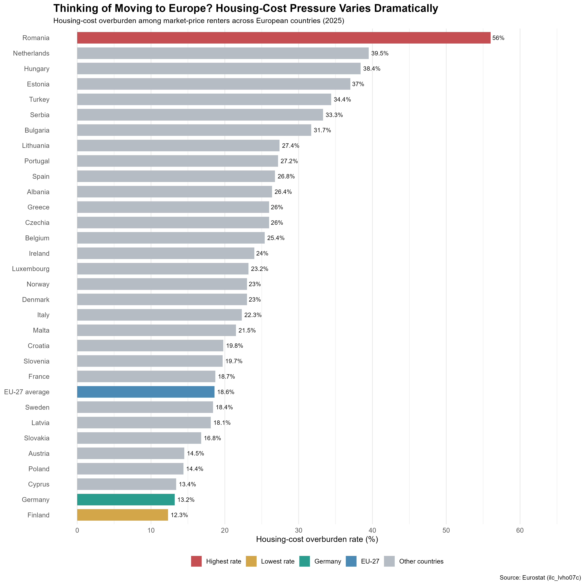
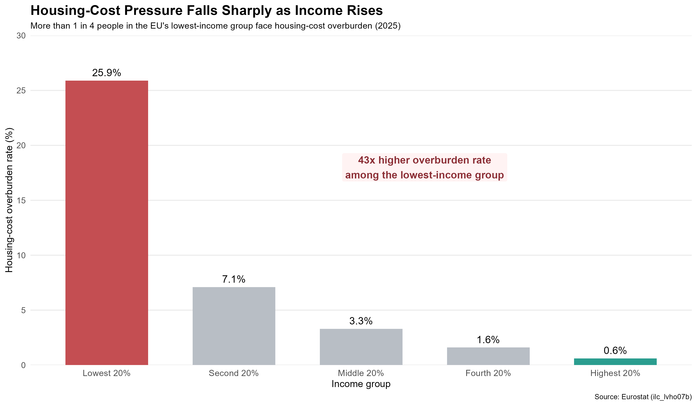
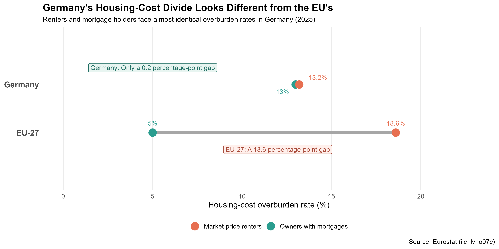
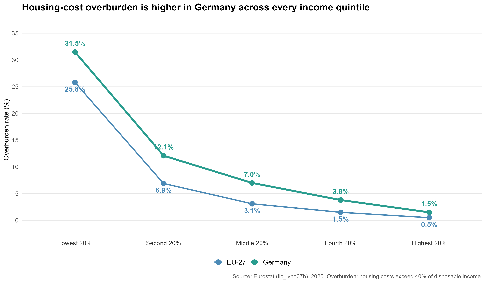
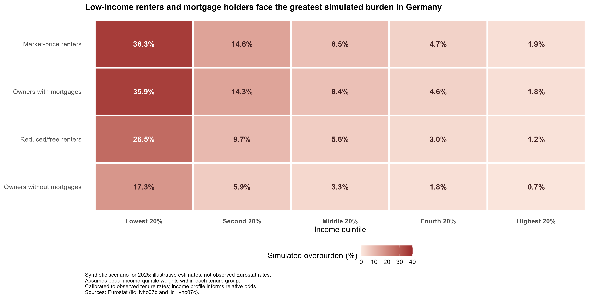
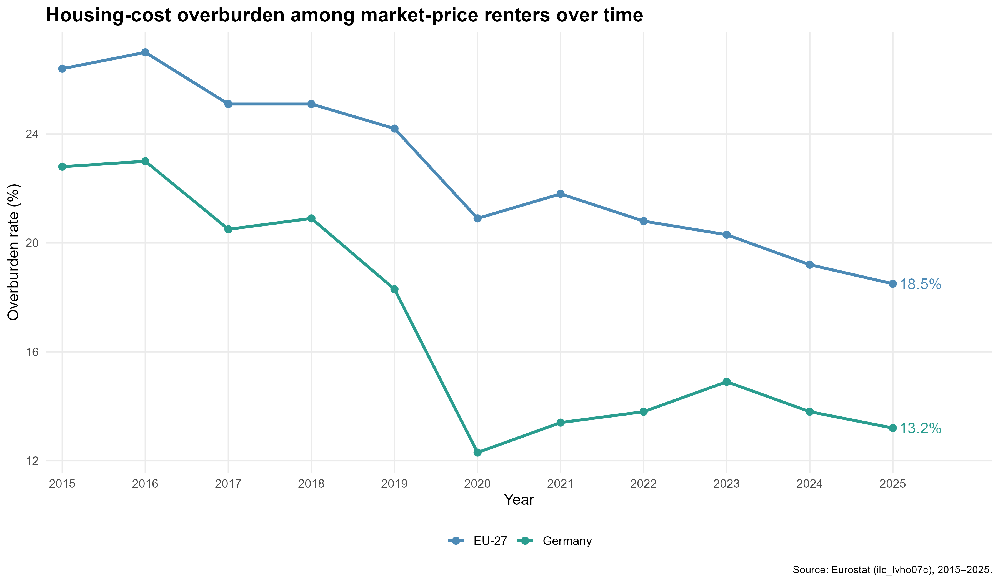

# The Rent Squeeze: Who Bears the Housing-Cost Burden in Europe?

## Project Overview

This project explores housing-cost pressure across Europe using Eurostat data. It investigates whether housing-cost overburden differs according to housing tenure, income level and geographical location, with particular attention to Germany and its position within the European Union.

Our visualisations are designed for people making real-life housing decisions, professionals considering relocation and researchers interested in housing affordability and inequality.

The project is developed as part of the Visual Communication and Data Storytelling course.

The project combines R and Python for data collection, analysis and visualisation. The R-based contribution is documented in detail below, while additional Python-based analyses and visualisations are being developed by other team members.

## Research Questions

1. Which tenure groups face the highest housing-cost burden across Europe?

2. How does the housing-cost burden of market-price renters differ between European countries?

3. How does housing-cost overburden across tenure and income groups in Germany compare with the broader European pattern?

## Target Audience and Personas

### Persona 1: Elena – A Renter Considering Homeownership

Elena is a 28-year-old working professional living in Germany. She currently rents an apartment but is considering buying a home.

She wants to understand whether renters experience greater housing-cost pressure than homeowners, particularly those with mortgages.

The visualisations help her compare housing-cost overburden across tenure groups and understand Germany's position within Europe.

### Persona 2: Ogiyonke – A Professional Considering Relocation to Europe

Ogiyonke is a 32-year-old South African IT professional who has received job offers in European countries and is considering relocating.

Before accepting an offer, she wants to understand how housing-cost pressure differs between countries, particularly for people renting at market prices.

The country comparisons provide useful context as she evaluates potential relocation destinations.

### Persona 3: Sofia – A Housing Policy Researcher

Sofia is a 35-year-old housing policy researcher based in Brussels.

She is interested in understanding housing affordability inequalities across Europe, particularly how housing-cost overburden differs between renters, homeowners and income groups.

She also wants to examine historical trends and understand whether Germany differs from the broader European pattern.

These three personas represent complementary perspectives: individual housing decisions, international relocation and housing policy research.

## Data Sources

The R analysis uses two official Eurostat datasets.

### 1. Housing-Cost Overburden by Tenure Status

- Dataset: `ilc_lvho07c`
- [Eurostat dataset](https://ec.europa.eu/eurostat/databrowser/view/ilc_lvho07c/default/table?lang=en)

The dataset provides housing-cost overburden rates across four housing tenure groups:

- Market-price renters
- Reduced-price or free renters
- Owners with a mortgage or housing loan
- Owners without a mortgage or housing loan

### 2. Housing-Cost Overburden by Income Quintile

- Dataset: `ilc_lvho07b`
- [Eurostat dataset](https://ec.europa.eu/eurostat/databrowser/view/ilc_lvho07b/default/table?lang=en)

The dataset provides housing-cost overburden rates across five income groups:

- First quintile: lowest-income 20%
- Second quintile: 20–40% of the income distribution
- Third quintile: 40–60% of the income distribution
- Fourth quintile: 60–80% of the income distribution
- Fifth quintile: highest-income 20%

The main R analysis focuses on 2025, while the historical analysis covers 2015–2025.

Country comparisons include European countries with available observations, using the EU-27 aggregate as a reference.

## What Is Housing-Cost Overburden?

Eurostat defines the housing-cost overburden rate as the percentage of people living in households where total housing costs account for more than 40% of disposable household income, with housing allowances taken into account.

This indicator measures housing affordability pressure rather than absolute rental prices or property prices.

---

## R-Based Analysis and Visualisations

This section documents the completed R-based contribution to the group project, including seven visualisations, automated Eurostat data collection, comparative analysis and synthetic scenario modelling.

Additional analyses and visualisations developed by other team members complement this contribution.

### R Analytical Workflow

The R analysis follows a reproducible workflow:

1. Automatic data retrieval from the official Eurostat API.
2. Conversion of Eurostat JSON-stat responses into structured data frames.
3. Saving local CSV data snapshots.
4. Data preparation and filtering.
5. Validation of selected observations.
6. Descriptive and comparative analysis.
7. Synthetic scenario modelling and calibration.
8. Visualisation and export.
9. Recording R session and package information.

The script automatically reuses saved datasets when available. This ensures that subsequent executions use the same data snapshots rather than potentially revised Eurostat observations.

The observed tenure-based and income-based analyses are conducted separately because the selected datasets do not directly provide joint observations of income and housing tenure.

## Completed R Visualisations

### Visualisation 1: Housing-Cost Overburden by Tenure in Germany

This bar chart compares housing-cost overburden across four housing tenure groups in Germany.

- Dataset: `ilc_lvho07c`
- Research question: RQ1 – Germany-specific component
- Target persona: Elena
- Visualisation type: Bar chart

**Key finding:** Market-price renters and homeowners with mortgages experience almost identical housing-cost overburden rates in Germany.

This helps Elena understand that homeownership with a mortgage does not necessarily correspond to a substantially lower overburden rate.



### Visualisation 2: Housing-Cost Overburden Among Market-Price Renters Across Europe

This visualisation compares housing-cost overburden among market-price renters across European countries.

Countries are ranked to make geographical differences easier to identify. Germany, the EU-27 aggregate and countries with particularly high or low rates provide important reference points.

- Dataset: `ilc_lvho07c`
- Research question: RQ2
- Target persona: Ogiyonke
- Visualisation type: Ranked horizontal bar chart

**Key finding:** Housing-cost overburden among market-price renters varies considerably across Europe.

This provides useful context for people considering relocation, although the indicator should not be interpreted as a direct comparison of rental prices.



### Visualisation 3: Housing-Cost Overburden Across EU Income Quintiles

This visualisation compares housing-cost overburden across the five EU income quintiles.

- Dataset: `ilc_lvho07b`
- Research focus: Income-related housing inequality
- Target persona: Sofia
- Visualisation type: Bar chart

**Key finding:** Housing-cost overburden disproportionately affects the lowest-income population.

The visualisation introduces income as an additional dimension of housing affordability and demonstrates that housing-cost pressure is not equally distributed across the population.



### Visualisation 4A: Germany and the EU – Tenure Comparison

This visualisation compares market-price renters and homeowners with mortgages in Germany and the EU-27.

- Dataset: `ilc_lvho07c`
- Research question: RQ3
- Target personas: Elena and Sofia
- Visualisation type: Faceted horizontal bar chart

**Key finding:** Germany differs from the broader European tenure pattern.

| Tenure group | Germany | EU-27 |
|---|---:|---:|
| Market-price renters | 13.2% | 18.5% |
| Owners with mortgages | 13.0% | 4.6% |
| Difference | 0.2 pp | 13.9 pp |

Across the EU, market-price renters experience substantially higher overburden rates than homeowners with mortgages.

In Germany, however, the two groups experience almost identical rates.

This finding motivates a deeper investigation into housing affordability across income groups.



### Visualisation 4B: Germany and the EU – Income Comparison

This visualisation compares housing-cost overburden across five income quintiles in Germany and the EU-27.

- Dataset: `ilc_lvho07b`
- Research question: RQ3
- Target persona: Sofia
- Visualisation type: Comparative income profile chart

**Key finding:** Germany records higher housing-cost overburden rates than the EU aggregate across every income quintile in the selected 2025 data.

| Income quintile | Germany | EU-27 |
|---|---:|---:|
| Lowest 20% | 31.5% | 25.8% |
| Second 20% | 12.1% | 6.9% |
| Middle 20% | 7.0% | 3.1% |
| Fourth 20% | 3.8% | 1.5% |
| Highest 20% | 1.5% | 0.5% |

The visualisation demonstrates that lower-income groups are particularly vulnerable to housing-cost pressure.

However, these income-related findings do not directly explain the tenure pattern identified in Visualisation 4A because the observed datasets represent separate population groupings.



### Visualisation 5: Synthetic Income and Tenure Scenario

This heatmap explores a hypothetical distribution of housing-cost overburden across income quintiles and tenure groups in Germany.

- Datasets: `ilc_lvho07b` and `ilc_lvho07c`
- Research focus: Exploratory income and tenure modelling
- Target personas: Elena and Sofia
- Visualisation type: Heatmap

**Key finding:** Under the model assumptions, low-income market-price renters and homeowners with mortgages experience the greatest simulated housing-cost burden.

The heatmap illustrates how housing affordability could be investigated if joint income and tenure observations were available.

The results are synthetic estimates and must not be interpreted as observed Eurostat statistics.



### Additional Visualisation: Historical Housing-Cost Trends

This time-series visualisation compares housing-cost overburden among market-price renters in Germany and the EU-27 between 2015 and 2025.

- Dataset: `ilc_lvho07c`
- Research question: Historical extension of RQ3
- Target personas: Ogiyonke and Sofia
- Visualisation type: Time-series line chart

**Key finding:** Housing-cost overburden among market-price renters shows an overall decline in both Germany and the EU-27 during the selected period.

Germany experienced a particularly sharp decline between 2019 and 2020.

In 2025, the German rate was 13.2%, compared with 18.5% for the EU-27.

The visualisation identifies historical patterns but does not establish the causes of these changes.



## Synthetic Data Methodology

### Motivation

The selected Eurostat datasets provide separate housing-cost overburden rates by tenure and income quintile.

However, they do not directly provide observed housing-cost overburden rates for every combination of income quintile and tenure group.

For example, the selected datasets do not directly tell us what percentage of Germany's lowest-income market-price renters experience housing-cost overburden.

A synthetic scenario was therefore developed to illustrate how these dimensions could be examined together.

### Model Assumptions

The synthetic model:

- Uses observed German tenure-specific overburden rates.
- Uses the observed income profile to inform relative odds.
- Assumes equal income-quintile weights within each tenure group.
- Calibrates simulated values to observed tenure-specific rates.
- Produces 20 hypothetical combinations of income and tenure.

The equal-weight assumption simplifies the model but does not necessarily represent the actual distribution of income across housing tenure groups in Germany.

### Calibration and Validation

Calibration checks assess whether the simulated values reproduce the observed tenure-specific target rates under the stated weighting assumption.

The synthetic dataset and calibration results are saved separately:

- `data/rent_squeeze_synthetic_income_tenure.csv`
- `data/rent_squeeze_synthetic_validation.csv`

The calibration checks passed successfully during execution of the R script.

However, successful calibration demonstrates internal consistency with the specified tenure targets. It does not establish that the simulated income-tenure combinations reflect actual population outcomes.

### Interpretation

The synthetic heatmap is an exploratory visualisation rather than an empirical estimate of joint housing-cost overburden.

Its purpose is to demonstrate the analytical value of examining income and housing tenure simultaneously.

Synthetic values must not be interpreted as:

- Observed Eurostat statistics.
- Verified population estimates.
- Individual predictions.
- Evidence of causal relationships.

## Visual Communication and Design

The R visualisations were developed using the following visual communication principles:

1. Selecting the appropriate data.
2. Choosing suitable visualisation types.
3. Configuring visualisations for meaningful comparisons.
4. Removing unnecessary visual noise.
5. Directing attention towards important findings.
6. Making visualisations approachable and readable.
7. Establishing trust through transparency and source attribution.

Following feedback, the visualisations were refined by:

- Removing redundant subtitles.
- Using a single title for each visualisation.
- Replacing dumbbell charts with alternative comparative visualisations.
- Improving labels, spacing and readability.
- Maintaining consistent colours where appropriate.
- Clearly distinguishing observed and synthetic data.
- Including source information and methodological notes.

## Key Findings from the R Analysis

### 1. Housing tenure matters

Housing-cost overburden differs across renters and homeowners.

In Germany, market-price renters and homeowners with mortgages experience almost identical overburden rates.

### 2. Geographical differences matter

Housing-cost overburden among market-price renters varies considerably across European countries.

National housing affordability conditions should therefore be considered when evaluating relocation destinations.

### 3. Income inequality matters

Housing-cost overburden is substantially higher among lower-income groups.

The income analysis demonstrates that housing affordability cannot be understood through tenure comparisons alone.

### 4. Germany differs from the broader European pattern

Germany has a lower market-price renter overburden rate than the EU aggregate but a higher mortgage-holder overburden rate.

Germany also records higher overburden rates across all five income quintiles in the selected 2025 observations.

These findings concern different population groupings and should not be interpreted as evidence that income directly explains Germany's tenure pattern.

### 5. Joint income and tenure data would support deeper analysis

The synthetic scenario demonstrates the potential value of investigating income and tenure together.

However, actual joint observations would be required to verify the simulated patterns.

## Limitations of the R Analysis

- Housing-cost overburden does not directly measure rental or property prices.
- National aggregates may conceal regional and city-level differences.
- Country coverage depends on available Eurostat observations.
- Eurostat data may be revised over time.
- Historical changes may reflect methodological changes as well as economic developments.
- The selected observed datasets do not establish joint income-tenure relationships.
- Synthetic estimates depend on modelling assumptions.
- Calibration does not establish external validity.
- Descriptive comparisons do not establish causality.

## Tools and Technologies

The group project uses both R and Python for analysis and visualisation.

### R-Based Contribution

- R
- jsonlite
- dplyr
- ggplot2

### Additional Project Tools

- Python
- Matplotlib
- forcats
- tidyr
- Quarto
- Positron
- Git and GitHub

Additional Python-based methodologies and visualisations are documented separately by the relevant team members.

## Repository Structure

The repository contains shared project resources, including analysis scripts, datasets and visualisations.

The following structure highlights the files associated with the R-based contribution. Additional group files are not exhaustively listed.

    The-Rent-Squeeze-/
    |
    |-- README.md
    |-- requirements.txt
    |-- .gitignore
    |
    |-- analysis/
    |   |-- rent_squeeze_analysis.R
    |   |-- Additional Python analysis scripts
    |
    |-- data/
    |   |-- rent_squeeze_ilc_lvho07b.csv
    |   |-- rent_squeeze_ilc_lvho07c.csv
    |   |-- rent_squeeze_session_info.txt
    |   |-- rent_squeeze_synthetic_income_tenure.csv
    |   |-- rent_squeeze_synthetic_validation.csv
    |   |-- Additional group datasets
    |
    |-- visualisations/
    |   |-- visual1_germany_redesigned.png
    |   |-- visual2_market_renters_redesigned.png
    |   |-- visual3_income_groups_redesigned.png
    |   |-- visual4a_germany_eu_tenure.png
    |   |-- visual4b_germany_eu_income.png
    |   |-- visual5_synthetic_income_tenure.png
    |   |-- optional_housing_cost_trends.png
    |
    |-- Additional group project resources

## Reproducing the R Analysis

The following instructions apply specifically to the R-based component of the project.

### Step 1: Clone the Repository

Run the following command in a terminal:

```bash
git clone https://github.com/CU-F26-MDSSB-MET-03-VisCommDataStory/The-Rent-Squeeze-.git
```

### Step 2: Open the Project

Open the cloned repository in Positron, RStudio or another R-compatible development environment.

Ensure that the working directory is the repository root.

### Step 3: Install the Required R Packages

If the required packages are not already installed, run the following command in the R console:

```r
install.packages(c("jsonlite", "dplyr", "ggplot2"))
```

### Step 4: Execute the Analysis

Run the following command in the R console:

```r
source("analysis/rent_squeeze_analysis.R")
```

The script automatically:

- Loads saved Eurostat data snapshots.
- Downloads data from the Eurostat API if snapshots are unavailable.
- Prepares and filters the data.
- Performs validation checks.
- Generates the synthetic scenario.
- Performs synthetic calibration checks.
- Exports all seven R visualisations.
- Saves synthetic data and validation results.
- Records R session information.

An internet connection is required when downloading datasets or installing packages.

### Step 5: Verify Successful Execution

Successful execution produces the following console message:

```text
Seven graphs exported. Synthetic calibration checks passed.
```

The seven generated graphs are saved in the `visualisations/` directory.

### Reproducibility Testing

The R analysis was successfully executed after restarting the R session, demonstrating that the script does not depend on previously created workspace objects.

The script was also successfully executed after being relocated to the `analysis/` directory.

The analysis was tested using R version 4.5.2.

Detailed R environment and package information is available in:

`data/rent_squeeze_session_info.txt`

The saved Eurostat snapshots allow the same source observations to be reused even if Eurostat subsequently revises its datasets.

Reproduction on a separate computer requires the relevant R packages and access to the repository files.

## Preliminary Interpretation of the R Findings

The R analysis demonstrates that housing affordability is not simply a question of renting versus owning.

Housing-cost pressure varies according to income, housing tenure and geographical location.

Germany presents an interesting contrast to the broader European pattern, particularly when comparing market-price renters and homeowners with mortgages.

The income analysis further demonstrates the importance of considering economic inequality when investigating housing affordability.

The synthetic scenario illustrates the potential benefits of examining income and tenure jointly, while acknowledging the limitations of the available observed data.

These findings contribute to the broader group data story and will be considered alongside the additional analyses and visualisations developed by other team members.

## Python-Based Analysis and Visualisations

This section documents the Python contribution: the context charts that show **how large each housing group is** (tenure shares) and **where** market-price renters and mortgage owners are overburdened across Europe (maps). They respond to the feedback that the story needs context before the overburden rates: who rents, who owns, and how big each group is.

### Python Analytical Workflow

1. Download two Eurostat tables with the `eurostat` Python package (`analysis/fetch_eurostat_data.py`):
   - `ilc_lvho07c`: housing-cost overburden rate by tenure.
   - `ilc_lvho02`: distribution of the population by tenure.
2. Convert the wide Eurostat tables to tidy long format (`geo`, `tenure`, `year`, `value`).
3. Filter `ilc_lvho02` to total population and all household types (`rskpovth = TOTAL`, `hhcomp = TOTAL`), then check that no country has more than one row per tenure and year.
4. Save the snapshots to `data/eurostat_overburden_by_tenure.csv` and `data/eurostat_tenure_shares.csv`.
5. Draw the stacked tenure chart and the maps from those saved CSV files.

The charts read the saved CSV files, not the live Eurostat API. Eurostat revises its data: the 2025 figures for the EU-27 and Denmark changed between our first export (9 Oct 2026) and the API download of 12 Nov 2026. Figures in the Python charts come from the 12 Nov 2026 download.

### Python Visualisations

**Stacked bar chart: who rents and who owns** (`visualisations/stacked_tenure_shares_2025.png`)

- Dataset: `ilc_lvho02`, 2025, total population.
- Each bar is one country, split into owners without a mortgage, owners with a mortgage, market-price renters and reduced-price or free renters. Countries are sorted by the share of tenants.
- Observations (2025):
  - Germany: 52.8% of people live as tenants, compared with 31.5% in the EU-27.
  - Mortgage owners are about a quarter of the population in both Germany (24.0%) and the EU-27 (24.8%).
  - In Italy, 59.9% of people own without a mortgage. This is a descriptive observation only; the data do not tell us why.
- Why it matters for the story: the overburden rate of a group means little without its size. It shows that the German mortgage-owner group is not small.

**Maps: housing-cost overburden by country** (`visualisations/map_overburden_RENT_MKT_2025.png`, `visualisations/map_overburden_OWN_L_2025.png`)

- Dataset: `ilc_lvho07c`, 2025.
- The first map shows market-price renters, the second owners with a mortgage. Darker colour means a larger share of people above the 40% line; the colour scale stops at 40%, so Romania (56.0%) does not hide the differences elsewhere. Grey means no data. The maps use an equal-area projection (ETRS89-LAEA, EPSG:3035, as in Eurostat's own maps), so country sizes are proportional to real areas.
- Observations, market-price renters (2025): Romania 56.0%, Netherlands 39.5%, Spain 26.8%, Italy 22.3%, Germany 13.2%, Finland 12.3%; EU-27 average 18.5%.
- Observations, owners with a mortgage (2025): Germany 13.0%, EU-27 4.6%.
- The maps compare rates of overburden. They do not compare rents or property prices.

### What the Python Part Adds to the Findings

- In Germany, mortgage owners and market-price renters have almost the same overburden rate (13.0% and 13.2%), and mortgage owners are about a quarter of the population. We do not yet know who these owners are or why their rate is this high.
- Tenure shares differ a lot between countries, so a country's overburden rate has to be read together with how many people are in each group.

### Limitations of the Python Part

- The tenure-share and overburden tables are separate Eurostat tables, so the charts show group size and group rate side by side but do not combine them.
- Neither table is split by income. We make no claim about how income and tenure relate; that would need household-level microdata.
- National figures can hide regional and city differences.
- Eurostat data are revised. Re-running the fetch script will download the current version, which can differ slightly from the figures above.
- Some countries have no value for some tenure groups or years (grey on the maps).
- Descriptive comparisons do not show causes.

### Reproducing the Python Analysis

Run these commands from the repository root (Windows PowerShell shown).

1. Create and activate a virtual environment, then install the packages:
   ```
   python -m venv .venv
   .venv\Scripts\activate
   python -m pip install -r requirements.txt
   python -m pip install geopandas
   ```
2. Download the data (needs an internet connection):
   ```
   python analysis/fetch_eurostat_data.py
   ```
   It prints the filter values and `duplicate geo/tenure/year rows after filtering (should be 0): 0`. If the number is not 0, do not continue.
3. Draw the charts:
   ```
   python analysis/stacked_tenure_shares.py 2025
   python analysis/map_overburden.py RENT_MKT 2025
   python analysis/map_overburden.py OWN_L 2025
   ```
   Other tenure codes for the map: `OWN_NL`, `RENT_FR`, `TOTAL`.
4. The images are saved in `visualisations/`.

Files used: `analysis/fetch_eurostat_data.py`, `analysis/stacked_tenure_shares.py`, `analysis/map_overburden.py`, `data/eurostat_tenure_shares.csv`, `data/eurostat_overburden_by_tenure.csv`, `data/europe_countries.geojson` (country outlines from Natural Earth, public domain).

Also in `analysis/`: `rent_squeeze_line_chart.py`, which draws the line chart for Germany, Italy, Spain and the EU-27 (owners with a mortgage) from the Excel export in `data/`.

## Data Attribution

Source: Eurostat, European Commission.

- Housing-cost overburden rate by tenure status (`ilc_lvho07c`)
- Housing-cost overburden rate by income quintile (`ilc_lvho07b`)

Observed R visualisations are based on Eurostat data.

Synthetic results are separately identified as illustrative model outputs.
